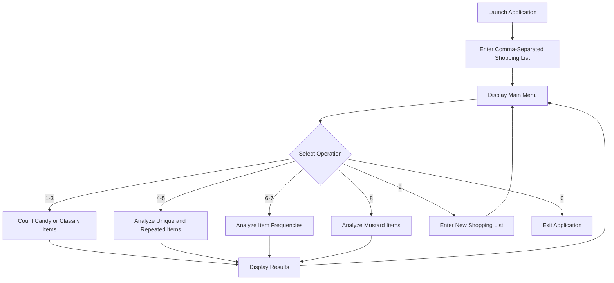

<div align="center">

# 🛒 Shopping List Analyzer

**A Java command-line application for analyzing shopping lists through string processing, item classification, and frequency analysis.**


*Java · String Manipulation · Arrays · ArrayList · Frequency Analysis · Menu-Driven Programming*

</div>

---

## Overview

**Shopping List Analyzer** is a Java console application that provides tools for inspecting and analyzing shopping lists.

Users enter a comma-separated list of food items and interact with a menu to perform operations such as counting specific ingredients, identifying single-word and multi-word items, examining duplicates, and analyzing item frequencies.

The application supports updating the shopping list during execution, allowing users to perform multiple analyses without restarting the program.

This project demonstrates fundamental Java programming concepts, including string manipulation, iterative algorithms, arrays, dynamic collections, conditional statements, and console input handling.

## Features

| | Feature | Description |
|:---:|---|---|
| 🍬 | **Candy counter** | Counts items containing "candy", ignoring capitalization. |
| 📝 | **Single-word detection** | Retrieves food items without spaces. |
| 📋 | **Multi-word detection** | Retrieves food items containing spaces. |
| ✨ | **Unique item identification** | Finds items appearing exactly once, regardless of capitalization. |
| 🔁 | **Repeated item detection** | Identifies repeated food items using frequency comparisons. |
| 📈 | **Most frequent item** | Finds an item with the highest occurrence count. |
| 📉 | **Least frequent item** | Provides an initial implementation of low-frequency item identification. |
| 🟡 | **Mustard analysis** | Counts and lists mustard-containing items. |
| 🔄 | **Dynamic list replacement** | Allows users to enter a different shopping list without restarting. |
| 💻 | **Interactive menu** | Provides nine analysis and input operations plus an exit command. |

> [!NOTE]
> Some frequency-related methods have known edge cases. These are documented in the [Current Limitations](#current-limitations) section.

## Application Workflow



### Available Menu Operations

| Option | Operation | Java Method |
|:---:|---|---|
| 1 | Count Candy | `countCandy()` |
| 2 | Get One-Word Food Items | `getOneWordFoodItems()` |
| 3 | Get Multi-Word Food Items | `getMultiWordFoodItems()` |
| 4 | Get Unique Food Items | `getUniqueFoodItems()` |
| 5 | Get Non-Unique Food Items | `getNonUniqueFoodItems()` |
| 6 | Get Most Frequent Food Item | `getMostFrequentFoodItem()` |
| 7 | Get Least Frequent Food Item | `getLeastFrequentFoodItem()` |
| 8 | Count Mustards | `countMustardsInList()` |
| 9 | Enter New Shopping List | `getNewList()` |
| 0 | Exit Application | — |

## Example Usage

### Step 1: Enter a Shopping List

When the application starts, enter a shopping list containing items separated by a comma followed by a space.

**Example input:**

```text
Candy, deli mustard, lettuce, CANDY, bag of candy
```

The program accepts both single-word and multi-word items.

### Step 2: Select an Operation

The application displays the following menu:

```text
What do you want to do?

1 = Count Candy
2 = Get One Word Food Items
3 = Get Multi-Word Food Items
4 = Get Unique Food Items
5 = Get Non-Unique Food Items
6 = Get Most Frequent Food Item
7 = Get Least Frequent Food Item
8 = Count Mustards
9 = Enter New List
0 = Quit
```

### Step 3: Review the Results

**Example: Count Candy**

Selecting option `1` analyzes the list for items containing the word "candy", regardless of capitalization.

```text
Number of Candy: 3
Number of Candy: 3
```

The current implementation prints this result twice because both the analysis method and the main menu handler display it.

**Example: Identify Unique Food Items**

Using the same list, option `4` identifies:

```text
deli mustard
lettuce
bag of candy
```

Each result currently appears twice in the console.

The analysis is case-insensitive, so `Candy` and `CANDY` are treated as the same item and excluded from the unique-item results.

## Getting Started

### Requirements

- Java Development Kit (JDK 8 or later)
- A terminal or Java-compatible IDE, such as Eclipse
- No third-party dependencies

### Run from the Terminal

Clone the repository:

```bash
git clone https://github.com/YuYinCheong/shopping-list-analyzer.git
```

Navigate to the project directory:

```bash
cd shopping-list-analyzer
```

Compile the Java source:

```bash
javac ShoppingListAnalyzer.java
```

Run the application:

```bash
java ShoppingListAnalyzer
```

Enter a comma-separated shopping list when the program starts.

### Run in Eclipse

1. Open Eclipse and create a new Java project.
2. Import `ShoppingListAnalyzer.java` into the project's `src` folder.
3. Right-click `ShoppingListAnalyzer.java`.
4. Select **Run As → Java Application**.
5. Enter the shopping list in the Console view.
6. Select menu options to perform different analyses.

> [!IMPORTANT]
> The current input parser uses `split(", ")`. Separate items with a comma **and a space**, such as `apple, banana, orange`, rather than `apple,banana,orange`.

## Technical Implementation

### Data Structures

| Data Structure | Purpose |
|---|---|
| `String[]` | Stores the shopping list provided by the user. |
| `ArrayList<String>` | Collects the results of item-filtering operations. |
| `int[]` | Tracks item occurrences during frequency analysis. |
| `Scanner` | Receives shopping-list input and menu selections. |

### String Processing

The application uses Java String methods to process shopping-list entries.

| Method | Purpose |
|---|---|
| `toLowerCase()` | Normalizes text for case-insensitive comparison. |
| `contains()` | Checks whether an item includes a specified word or space. |
| `equals()` | Compares item strings during duplicate detection. |
| `split()` | Converts comma-separated input into a String array. |

### Frequency Analysis

The frequency-processing methods use nested loops to compare shopping-list entries.

The basic approach is:

1. Normalize item names to lowercase.
2. Compare each item against previously encountered entries.
3. Track matching occurrences using an integer array.
4. Examine frequency counts to classify items or select results.

The implementation uses array-based counting rather than a `HashMap`.

Several edge cases in the repeated-item and frequency-selection methods remain open for improvement.

### Menu-Driven Architecture

The application uses a `while` loop and a `switch` statement to manage user interaction.

The menu continues to appear after each operation until the user enters `0`.

Users can replace the current shopping list with option `9`, without restarting the application.

## Current Limitations

The project currently has the following limitations:

- **Repeated-item handling:** The non-unique-item method can return duplicate results when an item appears more than twice.
- **Most-frequent tie-breaking:** When multiple items share the maximum frequency, the method selects the one appearing latest in the array, which does not always match the intended first-occurrence tie-breaking rule.
- **Least-frequent selection:** The method selects the first item whose frequency differs from the maximum, rather than calculating the actual minimum frequency. It can return an empty string when all items share the maximum count.
- **Mustard counting:** Repeated mustard items may be counted more than once when they appear three or more times.
- **Duplicate console output:** Several methods print their own results, which the `main()` method prints again.
- **Input validation:** Invalid non-integer menu selections are not handled gracefully.
- **Input formatting:** The parser expects a comma followed by a space between items.
- **Case normalization:** Several analysis methods modify the original String array by converting entries to lowercase.

## Possible Enhancements

Future improvements could include:

- Using `HashMap<String, Integer>` for more efficient and accurate frequency counting.
- Ensuring repeated food items appear only once in the results.
- Correcting most-frequent and least-frequent tie-breaking behavior.
- Improving mustard counting to identify distinct matching items.
- Separating analysis methods from console output.
- Adding validation for invalid menu selections and empty inputs.
- Supporting flexible comma-separated input with additional whitespace.
- Adding automated unit tests for duplicate detection and frequency analysis.
